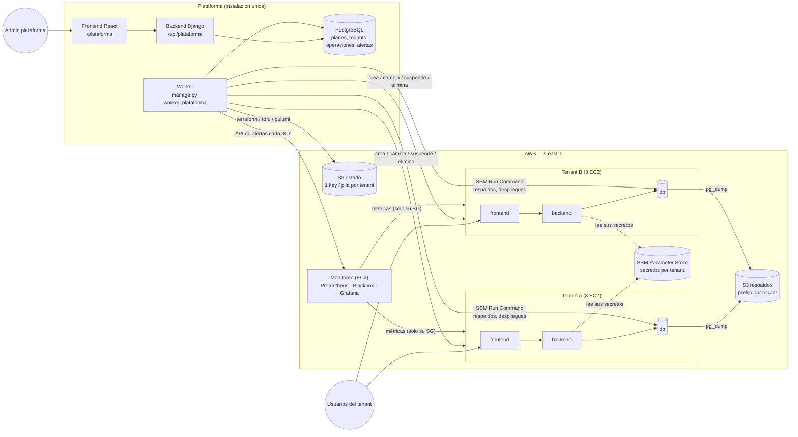
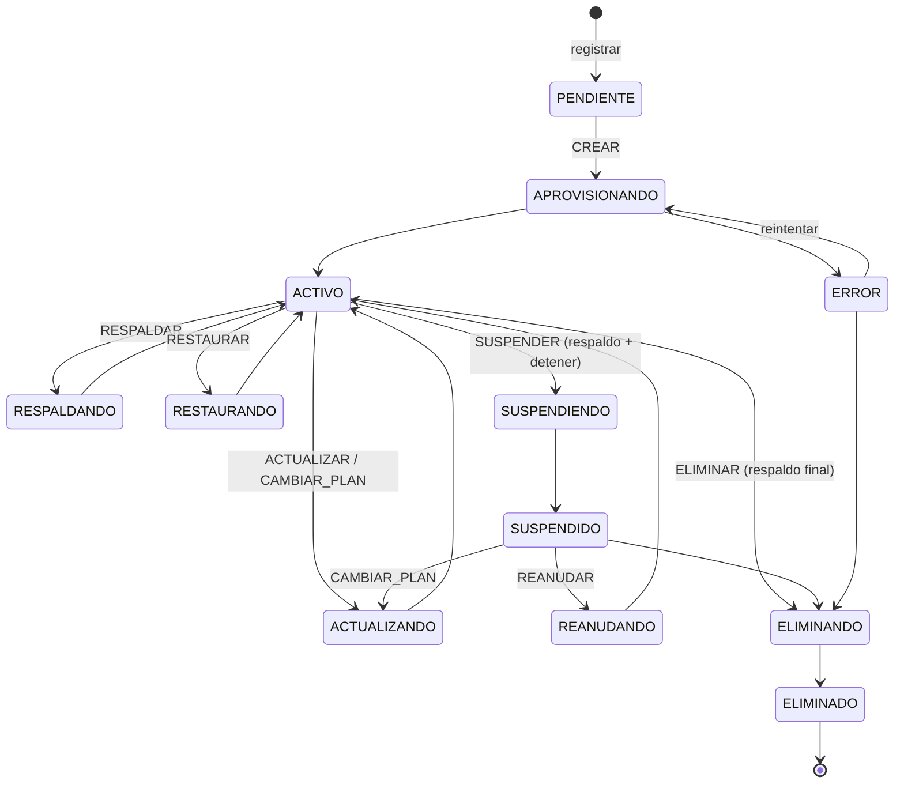

# Arquitectura de la plataforma de tenants

## Vista general



## Qué hace cada herramienta (sección 4 del enunciado)

| Herramienta | Función en esta arquitectura | Dónde |
|---|---|---|
| **Terraform / OpenTofu** | Motor principal: red, firewalls, roles IAM, secretos, 3 EC2 por tenant, suspender (detener instancias). Además el bucket de estado (`bootstrap/`) y el servidor de monitoreo | `infraestructura/terraform` |
| **Pulumi** | Segunda implementación del mismo tenant, elegible por tenant (RF-08) | `infraestructura/pulumi/tenant` |
| **CloudFormation** | Tercera implementación del mismo tenant, elegible por tenant; la plataforma completa lo que la pila no puede (secretos, `.env`, suspender) | `cloudformation/tenant`, [comparación](COMPARACION-MOTORES.md) |
| **cloud-init** | Configuración inicial de cada VM en su primer arranque: lee sus secretos de SSM, clona la app, migra, enciende servicios | `infraestructura/terraform/tenant/cloud-init` |
| **Packer** | Imagen base (AMI) con todo lo común ya instalado y endurecido: arranques de 1–3 min | `infraestructura/packer` |
| **Ansible** | Configuración posterior de la flota: endurecimiento, PostgreSQL según la memoria, actualizaciones masivas, verificación de salud; inventario dinámico por etiquetas, conexión por SSM | `infraestructura/ansible` |
| **Grafana** (+ Prometheus) | Métricas por tenant y entorno, tablero y 10 reglas de alerta; la plataforma muestra las alertas | `infraestructura/terraform/monitoreo` |

## Flujo de creación de un tenant

```mermaid
sequenceDiagram
  actor Admin as Admin de la plataforma
  participant UI as Frontend (/plataforma)
  participant API as Backend Django
  participant DB as Base de la plataforma
  participant W as Worker
  participant IaC as Terraform / OpenTofu / Pulumi
  participant AWS as AWS
  participant EC2 as EC2 del tenant (cloud-init)

  Admin->>UI: Nuevo tenant (datos, plan, entorno, motor)
  UI->>API: POST /tenants/
  API->>API: valida (identificador único, motor disponible)
  API->>DB: Tenant PENDIENTE + Operación CREAR PENDIENTE + Auditoría
  API-->>UI: 201 → pantalla de la operación
  loop cada 2 s (RF-11)
    UI->>API: GET /operaciones/<id>/ (progreso, paso, log sin secretos)
  end
  W->>DB: toma la operación (SELECT … FOR UPDATE SKIP LOCKED)
  W->>W: registra versiones (motor, plantillas, AMI, app) (RF-13)
  W->>IaC: init/plan/apply (estado propio en S3, con bloqueo)
  IaC->>AWS: SG, IAM, SSM (secretos), 3 EC2, IP elástica
  AWS-->>EC2: arranque
  EC2->>AWS: lee SUS secretos de SSM (rol IAM propio)
  EC2->>EC2: db: PostgreSQL · backend: Django+migraciones · frontend: build React
  IaC-->>W: salidas (URLs, instancias, IPs)
  W->>DB: Tenant ACTIVO · Operación EXITOSA (o FALLIDA + error comprensible)
  Note over W,DB: Si falla: «Reintentar» crea otra operación con los mismos datos;<br/>el motor compara contra el estado y solo crea lo que falta (RF-12)
```

## Estados de un tenant


Una sola operación a la vez por tenant (restricción en la base de datos). Si una operación falla
antes de tocar la infraestructura (por ejemplo, el respaldo previo), el tenant vuelve a su estado
anterior; si el motor llegó a ejecutarse, queda en `ERROR` para revisar y reintentar.

## Aislamiento entre tenants (modelo *silo*)

| Capa | Cómo se aísla | Se prueba en |
|---|---|---|
| Cómputo y datos | Cada tenant tiene sus 3 EC2 y su propia base PostgreSQL | — |
| Red | Security groups encadenados: internet → frontend → backend → db, **del mismo tenant** | `probar_aislamiento` (Red) |
| Secretos | SSM `/asistencia/<tenant>/<entorno>/…`; el rol IAM de cada instancia solo lee su ruta y su servicio | `probar_aislamiento` (Secretos) |
| Respaldos | Prefijo S3 `tenants/<tenant>/<entorno>/`; solo el rol de la db de ese tenant escribe ahí | `probar_aislamiento` (Respaldos) |
| Aplicación | `SECRET_KEY` distinta por tenant: un token de un tenant no vale en otro | `probar_aislamiento` (Aplicación) |
| Estado de IaC | Una key (Terraform) o pila (Pulumi, CloudFormation) por tenant: un error o `destroy` no toca a otros | — |
| Métricas | Puertos de métricas abiertos solo al security group del monitoreo | — |
| Plataforma | El admin de un tenant solo ve sus tenants, operaciones, respaldos y alertas | pruebas automáticas del backend |

## Seguridad de secretos y del estado
- Ningún secreto en el código, en los `.tfvars` ni en el `user_data`: los genera el motor y van a
  **SSM SecureString** (KMS). Las instancias los leen con su rol IAM.
- El **estado** sí contiene secretos: por eso vive en S3 **privado, cifrado (SSE-KMS), solo HTTPS,
  versionado y con bloqueo**, con una key por tenant. Pulumi además cifra los secretos con
  `PULUMI_CONFIG_PASSPHRASE`.
- Los logs de las operaciones pasan por un **redactor** que oculta contraseñas, tokens, llaves de
  AWS y bloques PEM; los errores técnicos se traducen a mensajes comprensibles (RF-11).
- IMDSv2 obligatorio y discos cifrados en todas las instancias; SSH cerrado (acceso por Session Manager).
