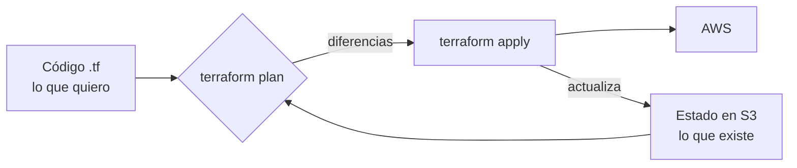
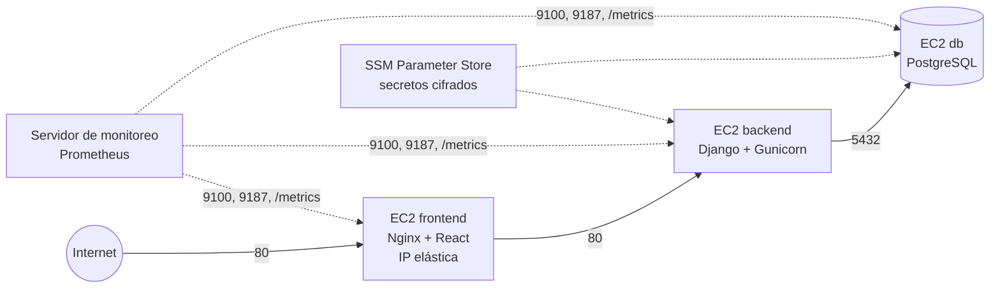
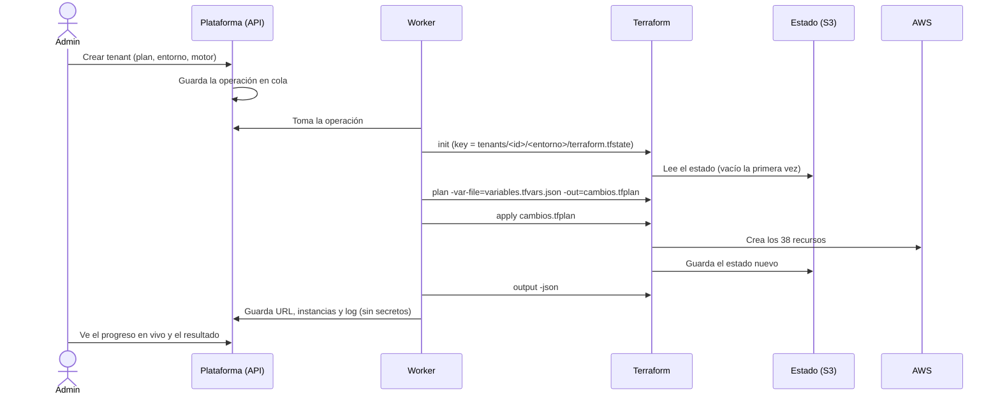

# Terraform en la plataforma de tenants

Material de apoyo para la exposición: qué es Terraform, cómo está organizado en este proyecto
y qué papel cumple en cada operación de la plataforma. Todas las cifras salen de operaciones
reales en AWS (cuenta del proyecto, región `us-east-1`).

---

## 1. La idea en una frase

> Cada institución (tenant) recibe **su propia infraestructura en AWS** —3 servidores EC2
> separados: frontend, backend y base de datos— y **Terraform es quien la crea, la modifica y
> la elimina**, siempre a partir del mismo código.

Sin Terraform, crear un tenant significaría unos 38 pasos manuales en la consola de AWS por
cada institución. Con Terraform es un botón en la plataforma, y el resultado es idéntico para
todos los tenants.

---

## 2. ¿Qué es Terraform?

Es una herramienta de **Infraestructura como Código (IaC)**: la infraestructura se describe en
archivos de texto (lenguaje HCL) y Terraform se encarga de que la nube quede igual a esa
descripción.

| Concepto | Qué significa | En este proyecto |
|---|---|---|
| **Declarativo** | Se describe *qué* se quiere, no *cómo* crearlo | "Quiero 3 instancias t3.micro con estos firewalls" |
| **Provider** | Plugin que habla con la API de un servicio | `aws`, `random` (contraseñas), `tls` (llave SSH) |
| **Recurso** | Cada cosa que Terraform administra | Una instancia, un security group, un secreto… |
| **Variables** | Los datos de entrada | Identificador del tenant, plan, entorno… |
| **Outputs** | Los datos de salida | URL de la app, IDs de las instancias… |
| **Estado (state)** | Lo que Terraform recuerda que creó | Un archivo por tenant en S3 |
| **plan** | Calcula las diferencias sin tocar nada | "Previsualizar cambios" |
| **apply** | Aplica esas diferencias | Crear, cambiar plan, suspender… |
| **destroy** | Elimina todo lo que creó | Eliminar tenant |

El ciclo siempre es el mismo:



**Idempotencia:** si se aplica dos veces el mismo código, la segunda vez no cambia nada
(`0 to add, 0 to change, 0 to destroy`). Por eso la plataforma puede **reintentar** una
operación fallida sin duplicar recursos: Terraform solo crea lo que falta.

---

## 3. Las tres configuraciones del proyecto

El código está en [`terraform/`](../terraform/) y se divide en tres partes, que se aplican en
este orden:

| Orden | Carpeta | Qué crea | Quién la aplica | Cuántas veces |
|---|---|---|---|---|
| 1 | [`bootstrap/`](../terraform/bootstrap/) | Bucket S3 del **estado** (versionado, cifrado, privado) y bucket de **respaldos** de las bases | El administrador, a mano | Una vez por cuenta |
| 2 | [`monitoreo/`](../terraform/monitoreo/) | Servidor de Prometheus + Grafana con su IP fija, rol IAM y firewall | El administrador, a mano | Una vez |
| 3 | [`tenant/`](../terraform/tenant/) | Toda la infraestructura de **un** tenant | **La plataforma, automáticamente** | Una vez por tenant y entorno |

`bootstrap` existe porque Terraform necesita un lugar donde guardar su estado antes de poder
crear cualquier otra cosa (el problema del huevo y la gallina). Además genera
`tenant/backend.hcl`, que conecta las otras configuraciones con ese bucket.

---

## 4. Anatomía de un tenant: 38 recursos

Al crear `colegio-madre-clara` con Terraform: `Plan: 38 to add` → `Apply complete! Resources:
38 added`. Están repartidos en archivos según su función:

| Archivo | Qué define | Recursos principales |
|---|---|---|
| [`versions.tf`](../terraform/tenant/versions.tf) | Versión mínima, providers, estado en S3, etiquetas | `backend "s3"`, `default_tags` |
| [`variables.tf`](../terraform/tenant/variables.tf) | Los datos de entrada, con validaciones | 16 variables |
| [`planes.tf`](../terraform/tenant/planes.tf) | Catálogo de planes (Básico, Estándar, Avanzado) | `locals` |
| [`red.tf`](../terraform/tenant/red.tf) | Firewalls y la IP pública fija | 3 `aws_security_group`, `aws_eip` |
| [`iam.tf`](../terraform/tenant/iam.tf) | Un rol por servidor, con permisos mínimos | 3 roles, políticas, 3 perfiles de instancia |
| [`secretos.tf`](../terraform/tenant/secretos.tf) | Contraseñas generadas y guardadas cifradas | `random_password`, `tls_private_key`, `aws_ssm_parameter` |
| [`instancias.tf`](../terraform/tenant/instancias.tf) | Los 3 servidores y su ciclo de vida | 3 `aws_instance`, `aws_ec2_instance_state`, `aws_eip_association` |
| [`outputs.tf`](../terraform/tenant/outputs.tf) | Lo que la plataforma muestra al usuario | 13 outputs |
| [`cloud-init/`](../terraform/tenant/cloud-init/) | Lo que instala cada servidor al primer arranque | PostgreSQL, Django + Gunicorn + Nginx, el frontend |

### La arquitectura que resulta



Cada flecha es una regla de un **security group**. La regla dice "desde el grupo X" y no
"desde una IP", así que **solo el backend de ese mismo tenant** puede llegar a su base de
datos. Un tenant no tiene ninguna ruta hacia los servidores de otro.

### Los planes son variables, no código distinto

Los tres planes usan la misma plantilla; solo cambian los valores:

| Plan | Frontend | Backend | Base de datos | Disco de la base |
|---|---|---|---|---|
| Básico | t3.micro | t3.micro | t3.micro | 10 GB |
| Estándar | t3.micro | t3.small | t3.small | 20 GB |
| Avanzado | t3.small | t3.medium | t3.medium | 40 GB |

El administrador puede editar los planes desde la plataforma. La plataforma envía los valores
concretos en la variable `recursos`, y Terraform los usa en lugar del catálogo de `planes.tf`.

---

## 5. Cómo se comunican la plataforma y Terraform

La plataforma (Django) **nunca crea recursos de AWS por su cuenta**: escribe las variables,
ejecuta Terraform y lee sus salidas.



Detalles que conviene mencionar:

- **Entrada:** un archivo `variables.tfvars.json` por tenant con su identificador, plan,
  recursos, versión de la app, etc. **Nunca incluye secretos.**
- **`plan -out` y luego `apply` de ese mismo plan:** se aplica exactamente lo que se calculó,
  aunque algo cambie entre medio.
- **Salida:** `terraform output -json` devuelve la URL de la app, los IDs de las instancias,
  sus IPs privadas y los comandos para leer las credenciales. Es lo que muestra la pantalla del
  tenant.
- **Trazabilidad:** cada operación registra la versión de Terraform y una huella (SHA-256) de
  las plantillas usadas. Se puede saber con qué código exacto se creó cada tenant.
- **Log sin secretos:** la salida de Terraform pasa por un filtro que oculta contraseñas antes
  de guardarse.

---

## 6. El estado: la memoria de Terraform

El estado es lo que permite a Terraform saber qué existe y qué debe cambiar. En el proyecto:

| Decisión | Por qué |
|---|---|
| Estado en **S3** y no en la PC | Lo comparten el administrador y la plataforma; no se pierde si se borra una carpeta |
| **Un archivo por tenant**: `tenants/<id>/<entorno>/terraform.tfstate` | Un error en un tenant no puede afectar a otro; también es aislamiento |
| Bucket **versionado** | Se puede recuperar una versión anterior del estado si algo sale mal |
| **Cifrado** y acceso público bloqueado | El estado contiene datos sensibles |
| **`use_lockfile`** (bloqueo nativo de S3, Terraform ≥ 1.10) | Dos operaciones simultáneas sobre el mismo tenant no pueden pisarse |

La plataforma también bloquea a su nivel: un tenant no puede tener dos operaciones en curso a
la vez.

---

## 7. Cada botón de la plataforma es una operación de Terraform

| Botón en la plataforma | Comando | Qué cambia en AWS | Caso real |
|---|---|---|---|
| **Crear tenant** | `plan` + `apply` | Se crean los 38 recursos | colegio-madre-clara: 38 added, 2 min 19 s |
| **Previsualizar cambios** | `plan` + `show -json` (no aplica nada) | Nada: muestra la lista de recursos que cambiarían | 35 s |
| **Cambiar plan** | `apply` con otros `recursos` | El tipo de instancia cambia **en sitio** (stop → cambiar → start); el disco solo crece. No se pierden datos ni la IP | — |
| **Suspender** | `apply` con `suspendido = true` | `aws_ec2_instance_state` pasa a `stopped`: se detienen los 3 servidores, se conservan discos e IP | colegio-madre-clara: 0 added, 6 changed, 1 min 23 s |
| **Reanudar** | `apply` con `suspendido = false` | Las instancias vuelven a `running` | — |
| **Actualizar** | `apply` | Corrige cualquier diferencia con el código (deriva) y despliega la nueva versión de la app | — |
| **Eliminar** | `destroy` (antes, un respaldo final) | Se borra todo lo del tenant | — |
| **Reintentar** | El mismo `apply` | Solo se crea lo que faltó (idempotencia) | josefina-goitia: el reintento creó 7 recursos, no 38 |

Lo más importante para la exposición: **suspender y cambiar de plan no son scripts
especiales.** Se cambia una variable y Terraform calcula el resto.

---

## 8. Seguridad incorporada en el código

| Práctica | Dónde |
|---|---|
| Sin credenciales de AWS en el código: se usan las del usuario (`aws configure`) o el rol del servidor | `versions.tf` |
| Contraseñas generadas por Terraform (`random_password`) y guardadas cifradas en SSM; los servidores las leen al arrancar | `secretos.tf` |
| Cada servidor tiene un rol IAM que **solo** puede leer los secretos de su propio tenant y servicio | `iam.tf` |
| IMDSv2 obligatorio, que protege las credenciales del rol frente a ataques SSRF | `instancias.tf` |
| Solo el frontend tiene IP pública; backend y base son privados | `red.tf` |
| Acceso a los servidores por **Session Manager**: el puerto SSH queda cerrado salvo que se configure `ssh_cidrs` | `iam.tf`, `red.tf` |
| Etiquetas automáticas (`Proyecto`, `Tenant`, `Entorno`, `Plan`, `GestionadoPor`) en todos los recursos | `default_tags` |
| Validaciones de las variables (formato del identificador, plan existente…) antes de tocar AWS | `variables.tf` |

---

## 9. Terraform frente a los otros motores

La plataforma permite elegir entre cuatro motores. Los cuatro reciben **las mismas variables**
y producen **las mismas salidas**, así que el resto de la plataforma no distingue cuál se usó.

| Motor | Lenguaje | Dónde guarda el estado | Crear (medido) |
|---|---|---|---|
| **Terraform** | HCL | S3 (el nuestro) | 2 min 19 s |
| **OpenTofu** | HCL (el mismo código) | S3 (el nuestro) | 1 min 30 s* |
| **Pulumi** | Python | S3 (el nuestro) | 2 min 55 s |
| **CloudFormation** | YAML | Lo administra AWS | 3 min 38 s |

\* La operación exitosa de OpenTofu fue un **reintento** que solo creó 7 recursos (el resto ya
existía), así que no es comparable con los demás. Las cifras se actualizan solas en la
plataforma, en *Motores*.

**OpenTofu** es la versión de código abierto de Terraform, mantenida por la Linux Foundation,
y usa exactamente los mismos archivos `.tf`. Que funcione sin cambios demuestra que el código
no depende de una empresa en particular.

Comparación completa: [COMPARACION-MOTORES.md](COMPARACION-MOTORES.md).

---

## 10. Un problema real y cómo se resolvió

Un buen ejemplo de cómo se trabaja con Terraform.

**Síntoma.** Cada tenant nuevo creado con Terraform u OpenTofu mostraba en Grafana alertas
críticas de "no responde a las métricas", aunque la aplicación funcionaba.

**Investigación.**
1. Prometheus no llegaba a los servidores del tenant: todas las conexiones agotaban el tiempo
   de espera. El síntoma apuntaba a un firewall.
2. Las reglas que dejan entrar al servidor de monitoreo **se habían creado** (aparecían en el
   log), pero ya no existían en AWS.
3. **CloudTrail** mostró que Terraform las había borrado en la **siguiente** aplicación (al
   suspender o al reintentar).
4. Pista adicional: "Previsualizar cambios" sobre un tenant ya creado mostraba `5 to add`.
   Terraform quería volver a crear esas mismas 5 reglas.

**Causa.** Los security groups tenían sus reglas escritas *dentro* del grupo (`ingress {}`) y
las reglas de métricas eran recursos *aparte*. Terraform toma las reglas en línea como la
lista completa del grupo, así que en cada aplicación borraba las otras por "sobrar".

**Solución.**
- Todas las reglas pasaron a estar dentro del grupo.
- Un bloque `removed { lifecycle { destroy = false } }` saca los recursos viejos del estado
  sin tocar AWS.
- Antes de aplicar se verificó con un `plan` sobre el estado real de un tenant:
  `0 to add, 3 to change, 0 to destroy`. Solo agrega las reglas que faltan, sin recrear
  servidores.

**Lección.** El `plan` es la herramienta más importante de Terraform: muestra qué va a pasar
antes de que pase. Un `plan` que nunca queda en cero suele indicar un conflicto en el código.

---

## 11. Comandos para mostrar en vivo

Los aplica la plataforma, pero se pueden mostrar a mano en la carpeta `terraform/tenant`:

```powershell
# Conectar con el estado de un tenant (solo lectura)
terraform init -backend-config=backend.hcl -backend-config="key=tenants/colegio-madre-clara/dev/terraform.tfstate"

# Qué recursos administra Terraform para ese tenant (son 38)
terraform state list

# Detalle de uno de ellos
terraform state show aws_instance.backend

# Qué cambiaría si se aplicara ahora (no modifica nada)
terraform plan -var-file=<variables del tenant>

# Las salidas que lee la plataforma
terraform output
```

En la plataforma:
- **Operaciones → detalle:** el log de Terraform en vivo (`plan`, `apply`, recursos creados).
- **Previsualizar cambios:** el resultado de un `plan` como tabla.
- **Motores:** la comparación de tiempos y tasa de éxito.

---

## 12. Preguntas que pueden hacer

**¿Por qué 3 instancias y no un solo servidor con Docker?**
Era un requisito del proyecto ("cada servicio en una EC2 diferente"). Además da aislamiento
real: cada servicio tiene su propio firewall y su propio rol IAM.

**¿Qué pasa si alguien cambia algo a mano en la consola de AWS?**
Es deriva (*drift*). El siguiente `plan` lo detecta y "Actualizar" lo devuelve al estado del
código. La plataforma además compara el estado real de las instancias y ofrece sincronizarlo.

**¿Qué pasa si falla a la mitad?**
Terraform guarda en el estado lo que alcanzó a crear. Al reintentar crea solo lo que falta. Lo
vimos con josefina-goitia: el primer intento chocó con un límite de la cuenta y el reintento
creó solo 7 recursos.

**¿Por qué no se recrean los servidores al actualizar la app?**
Los cambios de `user_data` se ignoran a propósito (`ignore_changes`). La nueva versión se
despliega en los mismos servidores, así la base de datos y la IP nunca se pierden.

**¿Cuánto cuesta un tenant?**
3 instancias t3.micro más disco y una IP elástica en el plan Básico. Suspendido solo se pagan
el disco y la IP. El límite de 5 IPs elásticas por región define cuántos tenants pueden existir
a la vez sin pedir más cuota.

---

## 13. Resumen

1. Terraform describe la infraestructura de un tenant en código: **38 recursos, 3 servidores
   aislados**.
2. **El mismo código sirve para todos los tenants**; lo que cambia son las variables (plan,
   entorno, identificador).
3. La plataforma **traduce cada botón** a `plan`, `apply` o `destroy` y muestra el progreso y
   el resultado.
4. El **estado en S3**, uno por tenant, con versiones y bloqueo, permite reintentar sin
   duplicar y mantiene los tenants independientes.
5. Al ser código, la infraestructura se **revisa, versiona, previsualiza y repite**, y el
   mismo código funciona con OpenTofu.
